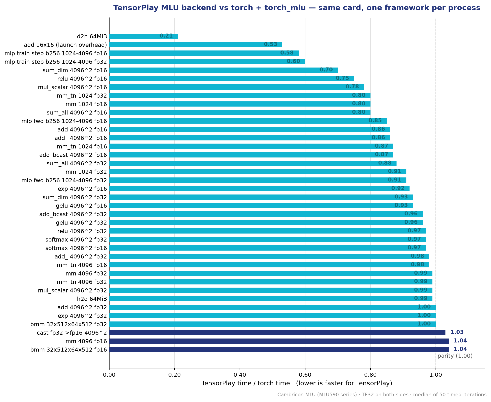

<p align="center">
  <picture>
    <source media="(prefers-color-scheme: dark)" srcset="docs/images/cambricon-lockup-white.png">
    <source media="(prefers-color-scheme: light)" srcset="docs/images/cambricon-lockup.png">
    
  </picture>
</p>

<h1 align="center">tensorplay-mlu</h1>

**Cambricon MLU backend for [TensorPlay]** — a native, out-of-tree device
backend that makes TensorPlay run on Cambricon MLU accelerators through the
CNRT driver and the CNNL kernel library.

```python
import tensorplay as tp
import tensorplay_mlu            # compiles the native part on first load

x = tp.randn(64, 64, device="mlu")
y = (x @ x).relu().sum()
print(y.item())
```

[](LICENSE)
[](https://www.python.org/)
[](https://github.com/lexing-2026/TensorPlay)

<p align="center"><a href="./README.md"><strong>English</strong></a> · <a href="./README.zh.md">中文</a></p>

---

## What this is

TensorPlay reserves one out-of-tree device slot (`PrivateUse1`) for
accelerators that live outside the framework.  This package fills that slot
for Cambricon MLU:

- memory comes from CNRT through a **caching allocator**;
- operators run on **CNNL** kernels;
- every operator without an MLU kernel yet runs on the **host** through the
  generic fallback, so models work end to end from day one;
- the device is spelled `"mlu"` in TensorPlay (`tp.ones(3, device="mlu")`).

The native sources ship inside the wheel and are compiled against the
installed Neuware toolkit the first time the backend is loaded, then cached
under `~/.cache/tensorplay_extensions`.

The same package ships a **MagicMind graph backend**: `tensorplay.compile(fn,
backend="magicmind")` lowers a captured region through Cambricon MagicMind and
runs it on the MLU — see [Graph compilation (MagicMind)](#graph-compilation-magicmind).

## Installation

### Requirements

- a Cambricon MLU card with the **Neuware toolkit** installed
  (`CNToolkit`, `CNNL`, ... — see the Cambricon user manuals)
- TensorPlay installed in the same environment (`pip install tensorplay`)
- the **MagicMind** SDK, only for the `magicmind` graph backend

### Environment variables

```bash
export NEUWARE_HOME=/usr/local/neuware   # Neuware toolkit install path
export LD_LIBRARY_PATH=$NEUWARE_HOME/lib64:$LD_LIBRARY_PATH
```

### Install the package

```bash
git clone https://github.com/ohtensorplay/tensorplay-mlu.git
cd tensorplay-mlu
pip install .            # or: pip install -e .
```

`import tensorplay` auto-loads the backend through the `tensorplay.backends`
entry point when `$NEUWARE_HOME` holds the toolkit.  You can also load it
explicitly:

```python
import tensorplay_mlu
tensorplay_mlu.load()
```

### Verify

```python
import tensorplay as tp
import tensorplay_mlu

tensorplay_mlu.load()
a = tp.randn(2, 3, device="mlu")
print((a.abs().sum()).cpu().item())   # needs an MLU server
```

## Quick start

```python
import tensorplay as tp
import tensorplay_mlu

tensorplay_mlu.load()
tp.manual_seed(0)

x = tp.randn(256, 256, device="mlu")
w = tp.randn(256, 256, device="mlu")

y = x @ w                # native CNNL matmul
z = y.relu().softmax(-1) # activations and reductions
loss = z.sum()
loss.backward()          # autograd works through the backend

print(z.cpu().shape, float(loss.cpu()))
```

## Supported operations

The backend implements the hot paths natively on CNNL:

| Area | Operators |
| --- | --- |
| Memory | `empty`, `*_like`, `copy_` (host/device, casts, broadcasting), `fill_`, `clone`, `item` |
| Binary | `add`/`sub`/`mul`/`div` with broadcasting, in-place and scalar forms |
| Unary | `exp`, `log`, `sqrt`, `pow`, activations (`relu`, `gelu`, `sigmoid`, ...) and their backward kernels |
| Blas | `mm`, `addmm`, `bmm`, `matmul`, `linear` (transposes read in place, cached algorithms) |
| Reduce | `sum`, `mean`, `amax`/`amin`, `softmax`/`log_softmax` with backward |
| Profiling | per-operation device time, kernel-level records through CNPAPI |

Everything else runs on the host through
`cpu_fallback::register_host_fallbacks`, so **every model runs**; data types
CNNL does not compute in (integers, `float64`) take the host path as well.

## Graph compilation (MagicMind)

`tensorplay.compile(fn, backend="magicmind")` lowers a captured region
through Cambricon **MagicMind** and runs it on the MLU.  The region is
exported to ONNX, parsed into a MagicMind network, and built into an MLU
model that is cached under `~/.cache/tensorplay-magicmind`.  The cache key
covers the graph, the sample shapes and dtypes, and the settings, so a
rebuild only happens when something that could change the binary changed.

```python
import tensorplay as tp
import tensorplay_mlu

tensorplay_mlu.load()

def region(x, w, bias):
    return tp.softmax(tp.relu(x @ w + bias), 1)

f = tp.compile(region, backend="magicmind")
x = tp.randn(8, 16, device="mlu")
w = tp.randn(16, 32, device="mlu")
b = tp.randn(32, device="mlu")
print(f(x, w, b).device)          # mlu
```

Options go through `options=` (or as flat keywords):

| Option | Meaning |
| --- | --- |
| `precision` | `"fp32"` (default) or `"fp16"` |
| `mlu_archs` | architectures the built binary targets, for example `["mtp_372"]`; unset lets the builder choose |
| `cache_dir` | directory for serialized models; `None` disables the disk cache |
| `pass_through_build_failures` | raise on a build failure instead of running the region uncompiled |

MagicMind is an optional dependency.  Without it the backend is reported as
unavailable and naming it in `tensorplay.compile` explains what to install.  A
region MagicMind cannot build stays on its interpreter, so a coverage gap
never fails the whole compile.

## Performance

`benchmark/bench_mlu_vs_torch.py` in the TensorPlay repository runs this
backend against `torch + torch_mlu` on the same card, one framework per
process, identical workloads.  The chart below shows the ratio on a
Cambricon MLU card (MLU590 series, TF32 on both sides, median of 50 timed
iterations); values below 1.00 mean TensorPlay is faster:

<p align="center">
  <picture>
    <source media="(prefers-color-scheme: dark)" srcset="docs/images/benchmark-ratio-dark.png">
    <source media="(prefers-color-scheme: light)" srcset="docs/images/benchmark-ratio.png">
    
  </picture>
</p>

Representative numbers:

| Case | torch ms | tensorplay ms | tp/torch |
| --- | ---: | ---: | ---: |
| mm 4096 fp32 | 1.72 | 1.71 | 0.99 |
| mm 1024 fp32 | 0.07 | 0.07 | 0.91 |
| add 4096² fp32 | 0.38 | 0.38 | 1.00 |
| relu 4096² fp32 | 0.15 | 0.14 | 0.97 |
| gelu 4096² fp32 | 0.21 | 0.20 | 0.96 |
| softmax 4096² fp32 | 0.21 | 0.20 | 0.97 |
| sum_all 4096² fp32 | 0.10 | 0.08 | 0.88 |
| bmm 32×512×64×512 fp32 | 0.07 | 0.07 | 1.00 |
| h2d 64 MiB | 5.10 | 5.03 | 0.99 |
| d2h 64 MiB | 26.7 | 5.6 | 0.21 |
| mlp train step fp32 | 0.82 | 0.50 | 0.60 |

Elementwise, reduction and memory operators are as fast as or faster than
`torch_mlu`; host→device copies match it and **device→host copies are about
5× faster**.  Full results are reproducible with:

```bash
cd <tensorplay-repo>
BENCH_FP32_PRECISION=high python benchmark/bench_mlu_vs_torch.py --per-case
```

> **Note on TF32.** `torch_mlu` always runs float32 matmuls in TF32 — its
> `allow_tf32` setter is a no-op in the shipped build.  The benchmark
> defaults to TF32 on both sides (`BENCH_FP32_PRECISION=high`) for a
> like-for-like comparison; set `BENCH_FP32_PRECISION=highest` to force full
> float32 on the TensorPlay side.

## Generic product names

CNNL selects its kernels and tiling tables by the product name the driver
reports.  Virtualized and rebranded cards can report a generic name (`mlu`;
CNNL logs "device name too short"), and CNNL then falls back to an
unknown-device configuration whose kernels fault the queue or return wrong
data without an error status: matrix products with 2 to 256 rows or above
2048 on a side, long reductions along the last axis, whole-tensor reductions
over 65536 elements, half precision elementwise operators above 32 MiB, and
every bfloat16 operator is refused.

`DeviceName.cpp` exports `cnDeviceGetName` ahead of the driver.  A name CNNL
recognizes (`MLU` followed by a digit) passes through; any other is replaced
by the series name for the chip's compute capability (`MLU590` for 5.x,
`MLU370` for 3.x).  Set `TP_MLU_DEVICE_NAME` to force a specific name.  The
replacement only takes effect when this library is loaded before anything
else that links the driver (such as another framework's MLU integration) in
the same process.

## Profiling

```python
from tensorplay.profiler import profile, ProfilerActivity

with profile(activities=[ProfilerActivity.CPU, ProfilerActivity.PrivateUse1]) as prof:
    train_step()
print(prof.key_averages().table(sort_by="device_time_total", row_limit=10))
```

Each operation gets its MLU time (notifiers on the device's queue) and, when
`libcnpapi.so` loads, the kernels, copies and fills it launched
(`prof.kineto_results()`, exported traces).  `profile(use_device="mlu")` asks
for the same.  `tensorplay.utils.count_host_fallbacks()` lists the operators
that still run on the host.

## Repository layout

| Path | Role |
| --- | --- |
| `tensorplay_mlu/csrc/MLURuntime.*` | errors, current device, one queue per device, per-thread CNNL handles |
| `tensorplay_mlu/csrc/MLUAllocator.*` | caching allocator over `cnrtMalloc`, memory statistics |
| `tensorplay_mlu/csrc/MLUHooks.cpp` | device count, synchronization, byte copies, memory info |
| `tensorplay_mlu/csrc/Cnnl.*` | tensor descriptors, workspaces, dense/strided copies, dtype rules |
| `tensorplay_mlu/csrc/DeviceName.cpp` | the product name the kernel library selects its kernels by |
| `tensorplay_mlu/csrc/CopyKernels.cpp` | `empty`, `*_like` factories, `copy_`, `fill_`, `clone` |
| `tensorplay_mlu/csrc/BinaryKernels.cpp` | add/sub/mul/div with broadcasting, in-place and scalar forms |
| `tensorplay_mlu/csrc/UnaryKernels.cpp` | exp/log/sqrt/..., `pow`, activations and their backward kernels |
| `tensorplay_mlu/csrc/BlasKernels.cpp` | `mm`, `addmm`, `bmm`, `matmul`, `linear` |
| `tensorplay_mlu/csrc/ReduceKernels.cpp` | `sum`, `mean`, `amax`/`amin`, softmax/log-softmax with backward |
| `tensorplay_mlu/csrc/MLUProfiler.cpp` | profiler device time: a notifier pair around each operation |
| `tensorplay_mlu/csrc/MLUActivity.cpp` | profiler kernel-level records through CNPAPI |
| `tensorplay_mlu/csrc/Module.cpp` | C entry points: host fallbacks, memory statistics |
| `tensorplay_mlu/csrc/NNKernels.cpp` | neural-network kernels: layer norm, dropout, embedding, NLL loss (forward/backward) |
| `tensorplay_mlu/compiler/` | MagicMind graph backend: ONNX lowering, content-addressed model cache, MLU execution |
| `tests/` | kernel-by-kernel comparison against the host |

## Versioning and compatibility

`tensorplay-mlu` is versioned independently of TensorPlay (semver, see
`pyproject.toml`).  It targets the out-of-tree device slot TensorPlay
reserves for accelerators, so the two projects move at their own pace:

| Component | Version / branch |
| --- | --- |
| `tensorplay-mlu` | `0.1.0` (this repository, `main`) |
| TensorPlay | any release that ships the `PrivateUse1` slot (`pip install tensorplay`) |
| Neuware toolkit | `CNToolkit` + `CNNL` from the Cambricon developer site |
| Tested card | MLU590 series (virtualized, generic product name) |

The native sources are compiled against the installed toolkit on first load
and cached under `~/.cache/tensorplay_extensions`, so a `pip install -U
tensorplay-mlu` picks up new kernels without rebuilding TensorPlay.

## Development

The test suite compares every kernel against the host and needs a Cambricon
MLU with the Neuware toolkit:

```bash
pip install pytest
pytest tests
```

How the out-of-tree slot works is documented in [Adding a device backend] in
the TensorPlay repository.

## License

[Apache License 2.0](LICENSE).

*Cambricon and the Cambricon logo are trademarks of Cambricon Technologies
Corporation Limited.  This project is not affiliated with or endorsed by
Cambricon.*

[TensorPlay]: https://github.com/lexing-2026/TensorPlay
[Adding a device backend]: https://github.com/lexing-2026/TensorPlay/blob/main/docs/source/notes/backends.md