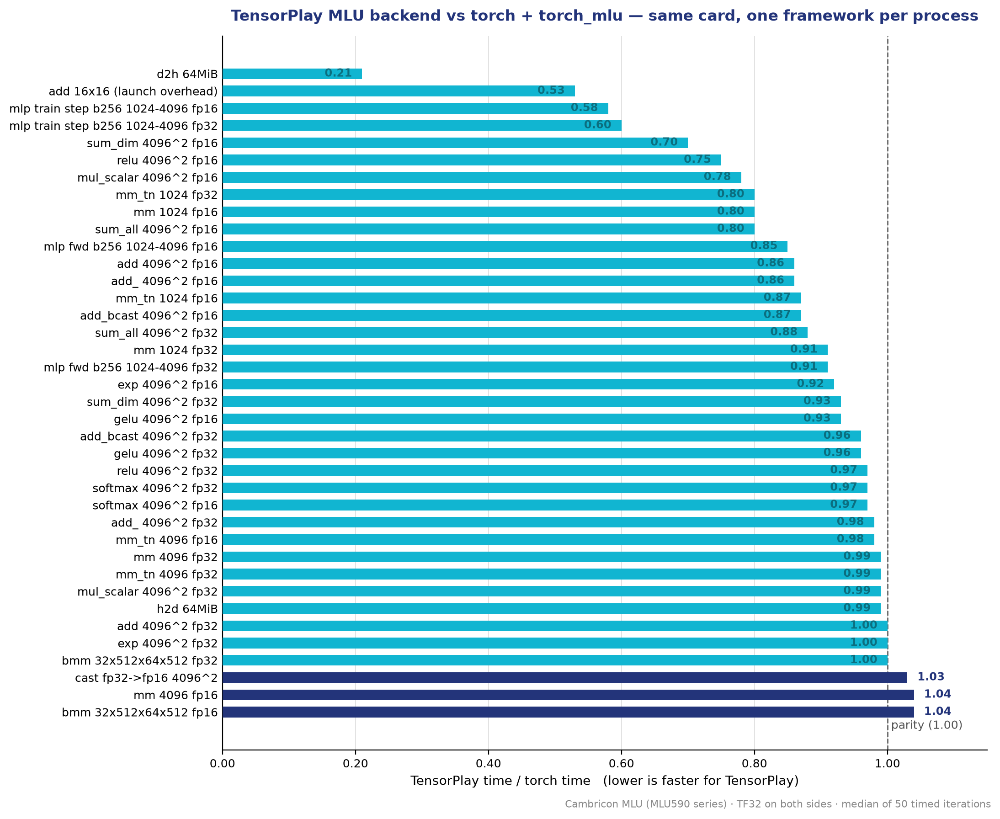

<p align="center">
  <picture>
    <source media="(prefers-color-scheme: dark)" srcset="docs/images/cambricon-lockup-white.png">
    <source media="(prefers-color-scheme: light)" srcset="docs/images/cambricon-lockup.png">
    
  </picture>
</p>

<h1 align="center">tensorplay-mlu</h1>

**TensorPlay 的寒武纪 MLU 后端** —— 一个原生的、仓库外的设备后端，通过
CNRT 驱动与 CNNL 内核库让 TensorPlay 跑在寒武纪 MLU 加速卡上。

```python
import tensorplay as tp
import tensorplay_mlu            # 首次加载时编译原生部分

x = tp.randn(64, 64, device="mlu")
y = (x @ x).relu().sum()
print(y.item())
```

[](LICENSE)
[](https://www.python.org/)
[](https://github.com/lexing-2026/TensorPlay)

<p align="center"><a href="./README.md"><strong>English</strong></a> · <a href="./README.zh.md">中文</a></p>

---

## 简介

TensorPlay 为框架之外的加速器预留了一个设备槽位（`PrivateUse1`）。本包为寒武纪
MLU 填充该槽位：

- 内存来自 CNRT，通过**缓存分配器**管理；
- 算子运行在 **CNNL** 内核上；
- 尚未提供 MLU 内核的算子会通过通用 fallback 在**主机**上运行，因此模型从一开始
  就能端到端跑通；
- 在 TensorPlay 中设备名写作 `"mlu"`（`tp.ones(3, device="mlu")`）。

原生源码随 wheel 一起分发，首次加载时针对已安装的 Neuware 工具链编译，并缓存在
`~/.cache/tensorplay_extensions` 下。

## 安装

### 依赖

- 一块寒武纪 MLU 卡，并安装 **Neuware 工具链**（`CNToolkit`、`CNNL` 等，安装方法见
  寒武纪官方用户手册）；
- 在同一环境中安装 TensorPlay（`pip install tensorplay`）。

### 环境变量

```bash
export NEUWARE_HOME=/usr/local/neuware   # Neuware 工具链安装路径
export LD_LIBRARY_PATH=$NEUWARE_HOME/lib64:$LD_LIBRARY_PATH
```

### 安装本包

```bash
git clone https://github.com/ohtensorplay/tensorplay-mlu.git
cd tensorplay-mlu
pip install .            # 或: pip install -e .
```

当 `$NEUWARE_HOME`（默认 `/usr/local/neuware`）存在工具链时，`import tensorplay`
会通过 `tensorplay.backends` 入口点自动加载本后端。也可以显式加载：

```python
import tensorplay_mlu
tensorplay_mlu.load()
```

### 验证安装

```python
import tensorplay as tp
import tensorplay_mlu

tensorplay_mlu.load()
a = tp.randn(2, 3, device="mlu")
print((a.abs().sum()).cpu().item())   # 需要在 MLU 服务器上运行
```

## 快速开始

```python
import tensorplay as tp
import tensorplay_mlu

tensorplay_mlu.load()
tp.manual_seed(0)

x = tp.randn(256, 256, device="mlu")
w = tp.randn(256, 256, device="mlu")

y = x @ w                # 原生 CNNL 矩阵乘
z = y.relu().softmax(-1) # 激活与归约
loss = z.sum()
loss.backward()          # autograd 在后端上正常工作

print(z.cpu().shape, float(loss.cpu()))
```

## 支持的算子

后端在 CNNL 上原生实现以下热路径：

| 类别 | 算子 |
| --- | --- |
| 内存 | `empty`、`*_like`、`copy_`（主机/设备、类型转换、广播）、`fill_`、`clone`、`item` |
| 二元 | `add`/`sub`/`mul`/`div`（广播、原地、标量形式） |
| 一元 | `exp`、`log`、`sqrt`、`pow`、激活（`relu`、`gelu`、`sigmoid` 等）及其反向内核 |
| Blas | `mm`、`addmm`、`bmm`、`matmul`、`linear`（原地读转置、算法缓存） |
| 归约 | `sum`、`mean`、`amax`/`amin`、`softmax`/`log_softmax` 及反向 |
| 性能剖析 | 逐算子设备时间、通过 CNPAPI 的内核级记录 |

其余算子通过 `cpu_fallback::register_host_fallbacks` 在主机上运行，因此
**任何模型都能跑通**；CNNL 不支持的数据类型（整数、`float64`）同样走主机路径。

## 性能

TensorPlay 仓库中的 `benchmark/bench_mlu_vs_torch.py` 在同一张卡上，以每个框架
独立进程、完全相同的负载，将本后端与 `torch + torch_mlu` 对比。下图给出在一张
寒武纪 MLU 卡（MLU590 系列，两侧均开启 TF32，50 次计时取中位数）上的比率；
小于 1.00 表示 TensorPlay 更快：

<p align="center">
  <picture>
    <source media="(prefers-color-scheme: dark)" srcset="docs/images/benchmark-ratio-dark.png">
    <source media="(prefers-color-scheme: light)" srcset="docs/images/benchmark-ratio.png">
    
  </picture>
</p>

代表性数据：

| 用例 | torch ms | tensorplay ms | tp/torch |
| --- | ---: | ---: | ---: |
| mm 4096 fp32 | 1.72 | 1.71 | 0.99 |
| mm 1024 fp32 | 0.07 | 0.07 | 0.91 |
| add 4096² fp32 | 0.38 | 0.38 | 1.00 |
| relu 4096² fp32 | 0.15 | 0.14 | 0.97 |
| gelu 4096² fp32 | 0.21 | 0.20 | 0.96 |
| softmax 4096² fp32 | 0.21 | 0.20 | 0.97 |
| sum_all 4096² fp32 | 0.10 | 0.08 | 0.88 |
| bmm 32×512×64×512 fp32 | 0.07 | 0.07 | 1.00 |
| h2d 64 MiB | 5.10 | 5.03 | 0.99 |
| d2h 64 MiB | 26.7 | 5.6 | 0.21 |
| mlp train step fp32 | 0.82 | 0.50 | 0.60 |

逐元素、归约和内存算子与 `torch_mlu` 相当或更快；主机→设备拷贝与其持平，
而**设备→主机拷贝大约快 5 倍**。完整结果可复现：

```bash
cd <tensorplay仓库>
BENCH_FP32_PRECISION=high python benchmark/bench_mlu_vs_torch.py --per-case
```

> **关于 TF32 的说明。** `torch_mlu` 的 float32 矩阵乘始终以 TF32 运行——其
> `allow_tf32` setter 在发行版中是 no-op。基准默认在两侧都开启 TF32
> （`BENCH_FP32_PRECISION=high`）以做同精度对比；设置为
> `BENCH_FP32_PRECISION=highest` 可强制 TensorPlay 一侧使用全精度 float32。

## 通用产品名问题

CNNL 会根据驱动上报的产品名选择内核与分块参数。虚拟化或改名的卡可能上报通用名
（`mlu`；CNNL 日志会报 "device name too short"），此时 CNNL 会回退到
unknown-device 配置，其内核会打崩队列或在无错误状态下返回错误数据：2 到 256 行
或单边超过 2048 的矩阵乘、沿最后一轴的长归约、超过 65536 个元素的整张归约、
超过 32 MiB 的半精度逐元素算子，以及所有 bfloat16 算子都会被拒绝。

`DeviceName.cpp` 在驱动之前导出 `cnDeviceGetName`。CNNL 能识别的名字
（`MLU` 加数字）会原样通过；其他名字会被替换为芯片计算能力对应的系列名
（5.x 用 `MLU590`，3.x 用 `MLU370`）。设置 `TP_MLU_DEVICE_NAME` 可强制指定名字。
只有在同一进程中本库先于其他链接驱动的库（例如其他框架的 MLU 集成）加载，
替换才会生效。

## 性能剖析

```python
from tensorplay.profiler import profile, ProfilerActivity

with profile(activities=[ProfilerActivity.CPU, ProfilerActivity.PrivateUse1]) as prof:
    train_step()
print(prof.key_averages().table(sort_by="device_time_total", row_limit=10))
```

每个算子都会得到其 MLU 时间（设备队列上的 notifier），当 `libcnpapi.so` 可加载时，
还会得到其启动的内核、拷贝与填充记录（`prof.kineto_results()`、导出 trace）。
`profile(use_device="mlu")` 请求同样的能力。`tensorplay.utils.count_host_fallbacks()`
会列出仍在主机上运行的算子。

## 仓库布局

| 路径 | 作用 |
| --- | --- |
| `tensorplay_mlu/csrc/MLURuntime.*` | 错误处理、当前设备、每设备队列、每线程 CNNL handle |
| `tensorplay_mlu/csrc/MLUAllocator.*` | 基于 `cnrtMalloc` 的缓存分配器、内存统计 |
| `tensorplay_mlu/csrc/MLUHooks.cpp` | 设备数量、同步、字节拷贝、内存信息 |
| `tensorplay_mlu/csrc/Cnnl.*` | 张量描述符、workspace、稠密/跨步拷贝、dtype 规则 |
| `tensorplay_mlu/csrc/DeviceName.cpp` | 内核库按之选择内核的产品名 |
| `tensorplay_mlu/csrc/CopyKernels.cpp` | `empty`、`*_like` 工厂、`copy_`、`fill_`、`clone` |
| `tensorplay_mlu/csrc/BinaryKernels.cpp` | 带广播的 add/sub/mul/div、原地与标量形式 |
| `tensorplay_mlu/csrc/UnaryKernels.cpp` | exp/log/sqrt/...、`pow`、激活及其反向内核 |
| `tensorplay_mlu/csrc/BlasKernels.cpp` | `mm`、`addmm`、`bmm`、`matmul`、`linear` |
| `tensorplay_mlu/csrc/ReduceKernels.cpp` | `sum`、`mean`、`amax`/`amin`、softmax/log-softmax 及反向 |
| `tensorplay_mlu/csrc/MLUProfiler.cpp` | 剖析器设备时间：每个算子前后一对 notifier |
| `tensorplay_mlu/csrc/MLUActivity.cpp` | 通过 CNPAPI 的剖析器内核级记录 |
| `tensorplay_mlu/csrc/Module.cpp` | C 入口点：主机 fallback、内存统计 |
| `tensorplay_mlu/csrc/NNKernels.cpp` | 神经网络内核：layer norm、dropout、embedding、NLL loss（前向/反向） |
| `tests/` | 与主机逐内核对比 |

## 版本与配套关系

`tensorplay-mlu` 独立于 TensorPlay 进行版本管理（semver，见 `pyproject.toml`）。
它针对 TensorPlay 为加速器预留的仓库外设备槽位，因此两个项目各自演进：

| 组件 | 版本 / 分支 |
| --- | --- |
| `tensorplay-mlu` | `0.1.0`（本仓库，`main` 分支） |
| TensorPlay | 任何带 `PrivateUse1` 槽位的发行版（`pip install tensorplay`） |
| Neuware 工具链 | 寒武纪开发者网站提供的 `CNToolkit` + `CNNL` |
| 已测卡型 | MLU590 系列（虚拟化、通用产品名） |

原生源码在首次加载时针对已安装的工具链编译，并缓存在
`~/.cache/tensorplay_extensions` 下，因此 `pip install -U tensorplay-mlu`
即可获得新内核，无需重新构建 TensorPlay。

## 开发

测试套件将每个内核与主机结果对比，需要寒武纪 MLU 与 Neuware 工具链：

```bash
pip install pytest
pytest tests
```

仓库外设备槽位的工作原理见 TensorPlay 仓库中的
[Adding a device backend](https://github.com/lexing-2026/TensorPlay/blob/main/docs/source/notes/backends.md)。

## License

[Apache License 2.0](LICENSE)。

*Cambricon 与 Cambricon logo 是寒武纪科技股份有限公司的商标。本项目与寒武纪
无隶属关系，亦未获得寒武纪背书。*